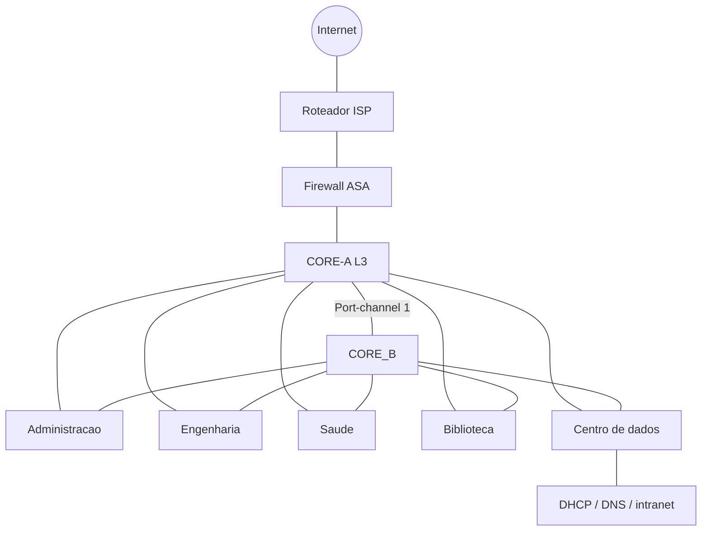

# Rede de campus universitario

Projeto de referencia para planejar e simular no Cisco Packet Tracer uma rede
segmentada, redundante e com servicos centralizados para uma universidade.

## Cenario

O campus tem quatro predios (Administracao, Engenharia, Saude e Biblioteca),
um centro de dados e acesso sem fio para estudantes e visitantes. O desenho usa
uma camada de nucleo L3 redundante, switches de acesso por predio, um firewall
na borda e servidores centrais.

Os enlaces duplos de cada switch de acesso terminam em switches de nucleo
distintos. Como o Packet Tracer nao simula um chassi virtual/MLAG entre os
nucleos independentes, o Rapid-PVST pode manter um dos caminhos de acesso em
blocking por VLAN. O HSRP fornece gateway redundante; as prioridades STP e
HSRP distribuem o encaminhamento entre CORE-A e CORE-B. O Port-channel 1 e
somente entre os dois nucleos.

## Arquivos

- [docs/arquitetura.md](docs/arquitetura.md): requisitos, topologia, VLANs,
  enderecamento e politicas.
- [docs/packet-tracer.md](docs/packet-tracer.md): equipamentos, montagem e
  testes da simulacao.
- [configs/core-a.cfg](configs/core-a.cfg) e [configs/core-b.cfg](configs/core-b.cfg):
  configuracao do nucleo L3 com HSRP e relay DHCP.
- [configs/access-switch.cfg](configs/access-switch.cfg): modelo de
  configuracao para switches de acesso.
- [configs/firewall-asa.cfg](configs/firewall-asa.cfg): exemplo para ASA 5505
  simulado.
- [configs/isp-router.cfg](configs/isp-router.cfg): roteador e rede externa
  para testes de conectividade/NAT.

## Comecar

1. Leia a arquitetura e confirme o plano de enderecamento.
2. Monte a topologia no Packet Tracer seguindo o roteiro.
3. Aplique as configuracoes de referencia, ajustando nomes e portas aos
   equipamentos escolhidos.
4. Salve a simulacao como `campus-universitario.pkt` nesta pasta.
5. Execute os testes de conectividade e de failover descritos no roteiro.

Os enderecos publicos `203.0.113.0/30` sao reservados para documentacao
(TEST-NET-3); substitua-os caso conecte a simulacao a uma rede real.
